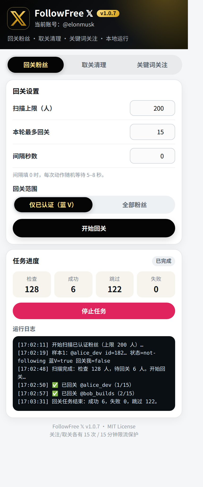
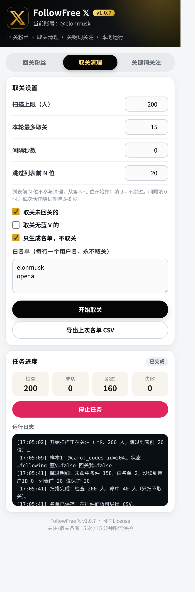
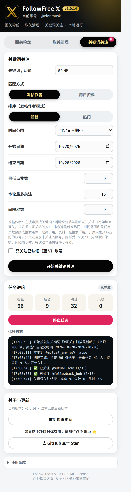

# FollowFree 𝕏 — 𝕏 回关/取关助手

一个免费、开源的 Chrome 扩展（Manifest V3），用来管理 𝕏（Twitter）的关注关系：批量回关粉丝、清理正在关注里未回关或无蓝 V 的账号、按关键词 / 话题关注发帖人。

所有任务都在你自己的浏览器和 𝕏 登录会话里完成，**没有后端服务器、没有账号绑定、没有统计上报**，数据只保存在本机。

## 功能

### 回关粉丝

- 扫描「已认证粉丝」列表，或切换为扫描全部粉丝
- 回关范围开关：仅已认证（蓝 V）/ 全部粉丝，二选一
- 自动滚动列表逐行采集，识别每个粉丝的蓝 V 标记和当前关注状态
- 只对尚未关注的粉丝发起回关，逐个执行、逐个记录结果
- 每个回关动作后用只读接口复核一次关系是否真的建立，未确认的不重复发送
- 扫描上限可调（1–500 人），本轮最多回关人数可调

### 取关清理

- 扫描「正在关注」列表，自动滚动采集
- 按条件筛选命中对象，可单选也可组合：
  - 未回关（没有「Follows you / 关注你」徽标）
  - 无蓝 V（没有认证标记）
- 跳过列表前 N 位：默认 20，列表前 N 位不参与清理，从第 N+1 位开始算；填 0 = 不跳过
- 白名单：每行填一个用户名，名单内账号永不取关
- 「只生成名单」模式：只扫描、只出名单，不执行任何取关
- 名单可导出 CSV（用户名 + 命中原因），先看名单再决定动不动手
- 批量取关，逐个执行、逐个记录结果

### 关键词关注 

- 发帖作者（默认）：在 𝕏 搜索页按关键词 / 话题滚动采集发帖人并关注，比如填 #互关，关注发过互关帖的人；发帖人去重，关注前先查是否已关注
- 发帖作者模式可按排序筛选：最新 / 热门；还可加时间范围（24 小时 / 7 天 / 30 天内，或自定义日期）和最低点赞数门槛，一起拼成搜索条件由 𝕏 服务端筛
- 用户资料：在 𝕏 搜索「用户」页采集资料匹配的账号
- 只关注当前未关注的账号
- 可选只关注已认证（蓝 V）账号；本轮最多关注数可调，同样受 15 次 / 15 分钟限流保护
- 每个关注动作后用只读接口复核一次关系是否真的建立

### 节奏与防误操作

- 关注、取关各有一条 **15 次 / 15 分钟** 的滑动窗口硬顶，达上限自动等待窗口滑出再继续
- 动作间隔默认随机 5–8 秒，也可自定义固定秒数
- 𝕏 返回限流（HTTP 429 或限流错误码）时立即结束本轮，不硬撞
- 取关记录本地保留 30 天：回关扫描会自动跳过近期取关过的账号，避免刚取关又回关
- 列表滚动失效或页面结构异常时自动停扫报错，不盲目继续
- 任务可随时停止；面板实时显示检查 / 成功 / 跳过 / 失败计数和逐条日志

### 隐私与数据

- 权限只有 `storage` 一项；只访问 `x.com` 和 `twitter.com`
- 不索要 𝕏 密码、不读取并外传任何登录凭证；调用 𝕏 接口用的是你浏览器当前的登录会话
- 全部数据（设置、任务进度、限流计数、白名单、取关记录）都存在 `chrome.storage.local`
- 无远程代码、无第三方 SDK、无任何向外发送的统计或日志

## 安装

1. 下载本仓库并解压（或 `git clone`），得到包含 `manifest.json` 的文件夹
2. Chrome 打开 `chrome://extensions`，开启右上角「开发者模式」
3. 点击「加载已解压的扩展程序」，选择该文件夹
4. 登录 x.com，点击浏览器工具栏的 FollowFree 𝕏 图标打开面板

## 使用

**回关**：切到「回关粉丝」标签 → 选回关范围（仅已认证 / 全部粉丝）→ 设扫描上限、本轮最多回关数、间隔 → 点「开始回关」。插件会自动打开你的粉丝列表页扫描并执行，离开列表页或关闭该标签会中断任务（已记录的计数不丢）。

**取关**：切到「取关清理」标签 → 勾筛选条件、填白名单、设「跳过列表前 N 位」（默认 20，保护列表顶部的账号）→ 建议先勾「只生成名单」跑一遍并导出 CSV 确认 → 再取消勾选正式执行。

**关键词关注**：切到「关键词关注」标签 → 填关键词 / 话题（如 `#互关`）→ 选匹配方式（发帖作者 / 用户资料）→ 发帖作者模式下再选排序（最新 / 热门）、时间范围、最低点赞数 → 设本轮最多关注数 → 点「开始关键词关注」。插件会自动跳到对应的搜索页扫描并执行；第一次用建议把本轮上限填小（比如 5）先跑一轮，看日志里的成功 / 跳过数再放量。常用组合：`#互关` + 最新 + 7 天内 + 点赞 ≥ 10，即「最近一周发互关帖、且帖子有点热度的人」。

## 注意事项

- 本扩展依赖 𝕏 网页端的页面结构和接口，𝕏 改版后可能需要同步更新采集规则
- 自动化关注/取关存在平台规则风险，请自行控制频率与规模，风险自担
- 关键词批量关注时，话题帖作者里可能混有营销号 / 僵尸号，建议先小量试跑、看日志确认质量后再放量
- 任务运行在列表页的标签中，执行期间不要关闭那个标签页
- 刚更新 / 重装扩展后，已打开的 𝕏 标签页里还没有新版插件脚本：点开始前请先按 F5 刷新一次 𝕏 页面（面板现在会先自动注入重试，实在进不去才会提示刷新）

## 开发

无构建步骤，纯原生 JS/CSS：

- `manifest.json` — MV3 配置（仅 `storage` 权限）
- `content.js` — 注入 𝕏 页面的任务引擎：列表扫描、接口调用、限流与防重复
- `popup.html` / `popup.css` / `popup.js` — 三标签操作面板（回关粉丝 / 取关清理 / 关键词关注）

改完代码后在 `chrome://extensions` 点扩展的刷新按钮即可生效。欢迎提 Issue 和 PR。

## 使用条款

使用本插件即表示你同意以下条款，其中第一条是核心：

1. **风险自担**：自动化关注 / 取关可能触发 𝕏 限流、功能限制甚至封号；由此造成的任何账号损失与后果均由使用者自行承担，作者不承担任何责任。
2. **用途**：本插件仅供个人学习与效率使用；请遵守 𝕏 平台规则与你所在地的法律法规。
3. **数据**：所有操作均在你自己的浏览器与登录会话内完成，不经过作者的服务器；作者不收集、不存储任何账号、密码或个人数据。
4. **按现状提供**：本插件免费、开源，按现状（AS IS）提供，不作任何明示或暗示的保证；𝕏 改版可能导致部分功能失效，恕不另行通知。
5. **禁止滥用**：请勿将本插件用于批量骚扰、刷量、营销群发或其他违规用途；由此产生的后果由使用者承担。

## 版本说明

当前版本：**v1.0.14**（2026-10-26）。

v1.0.14 发帖作者模式改用用户名直接关注（不再查用户 ID）、时间范围支持自定义日期。完整历史见 [CHANGELOG.md](CHANGELOG.md)。

## License

[MIT](LICENSE)
